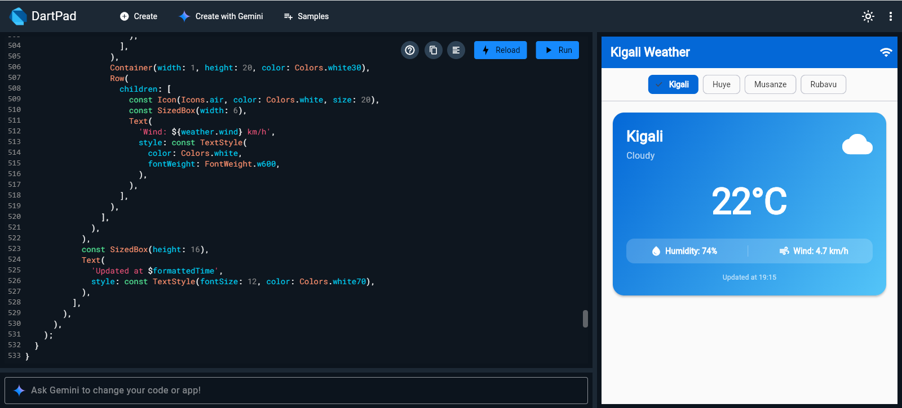
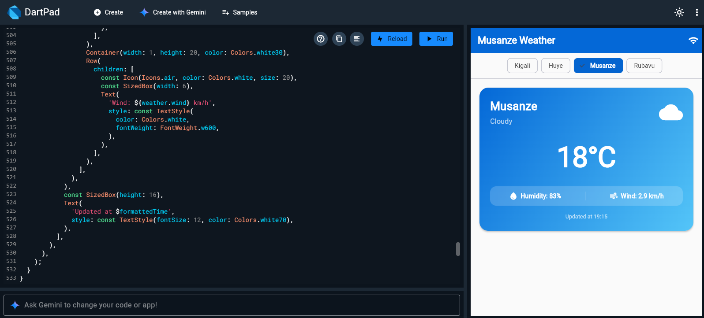
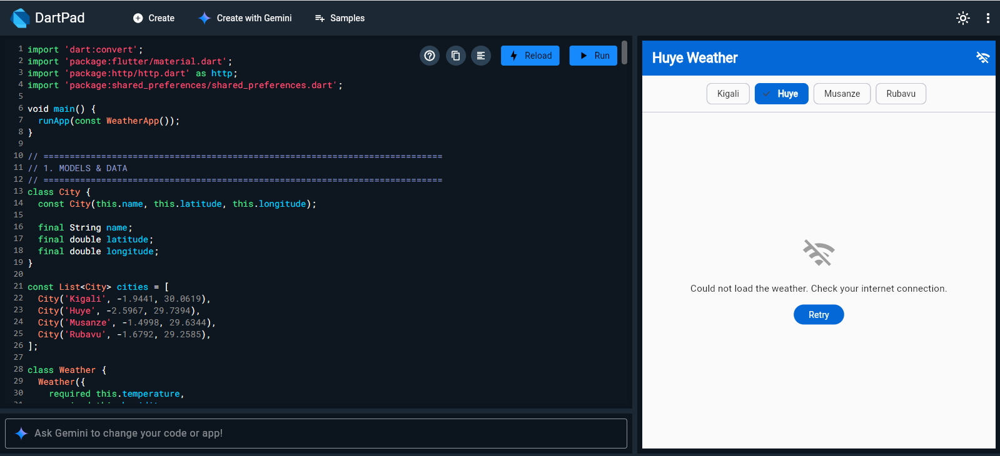
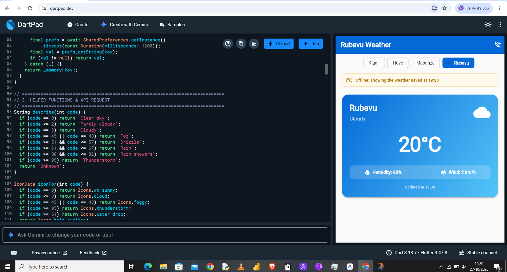

# Kigali Weather

A real-time weather application for Rwanda built with Flutter, fetching live data from the Open-Meteo API with offline caching via SharedPreferences.

---

## Features

1. **Live Open-Meteo Weather Data**:
   - Fetches live temperature, relative humidity, wind speed, weather code, and timestamp from the Open-Meteo forecast API for Rwanda.
   - Clean data mapping via `Weather.fromJson()` converting JSON into strong Dart types.

2. **Three UI States (Waiting without Freezing)**:
   - **Loading State**: Displays a `CircularProgressIndicator` while the asynchronous `Future` resolves without blocking the UI thread.
   - **Error State**: Graceful error handling (`try/catch`) showing a `Icons.wifi_off` icon, clear user-friendly explanation, and a **Retry** button.
   - **Data State**: Beautiful weather card with condition icons, rounded temperatures, and weather details.

3. **Rwanda City Switching**:
   - Interactive `ChoiceChip`s to switch between **Kigali**, **Huye**, **Musanze**, and **Rubavu**.
   - Each city's exact latitude and longitude queries its specific live weather report.

4. **Weather Card with Pull-to-Refresh**:
   - Rounded weather card featuring dynamic sky condition icons (`wb_sunny`, `cloud`, `foggy`, `thunderstorm`, `water_drop`) and verbal sky descriptions (e.g., *Clear sky*, *Partly cloudy*, *Rain showers*).
   - Metrics for humidity percentage and wind speed (km/h).
   - "Updated at" timestamp and `RefreshIndicator` enabling pull-down refresh.

5. **Persistence & Offline Caching (SharedPreferences)**:
   - **City Selection**: Automatically remembers and restores the last selected city on app launch.
   - **Offline Fallback**: Converts `Weather` models into JSON via `toJson()` and caches them under `'weather_${city.name}'`.
   - **Offline Warning Banner**: If the network connection drops or fails, displays the last saved weather with a banner: *"Offline: showing the weather saved at 12:30"*.

---

## Screenshots

### 1. Live Weather Dashboard (Kigali)

### 2. City Switching (Huye / Musanze)

### 3. No Internet Error Screen & Retry

### 4. Offline Cached Weather Banner

---

## Think Answers

### 1. What would happen to your screen if `http.get` made the app wait without `async` and `await`? Why does that matter more on a slow connection?
If `http.get` were synchronous and executed on Flutter's main thread (the UI thread) without `async` and `await`, the entire application engine would be blocked until the server answered. The user interface would completely freeze: animations, spinners, button presses, and frame rendering would stop, and the operating system might prompt the user with an "Application Not Responding" (ANR) dialog. On a slow, flaky, or congested cellular connection (common on mobile networks in Rwanda), waiting several seconds would turn the app into an unusable, frozen screen. Using `async`, `await`, and `Future` allows Flutter's event loop to continue rendering frames at 60/120 fps and displaying an active progress spinner while the operating system handles the network I/O in the background.

### 2. In your assignment, your mini project saves its data on the phone. What happens to that data when you change phone, or open the app on a second phone? What kind of place would keep it for every phone?
Data saved via `shared_preferences` is stored locally in the device's sandbox storage (such as Android SharedPreferences / SQLite / browser LocalStorage). When a user changes phones or accesses the app on a second device, that data is completely absent because local storage is isolated to the physical device. To make data persistent across different devices and accessible anywhere, it must be stored in a centralized remote database/backend server (such as Firebase Firestore, a RESTful API backed by PostgreSQL/MySQL, or Supabase). The app on each device would then authenticate the user and synchronize the data with the remote cloud server.
